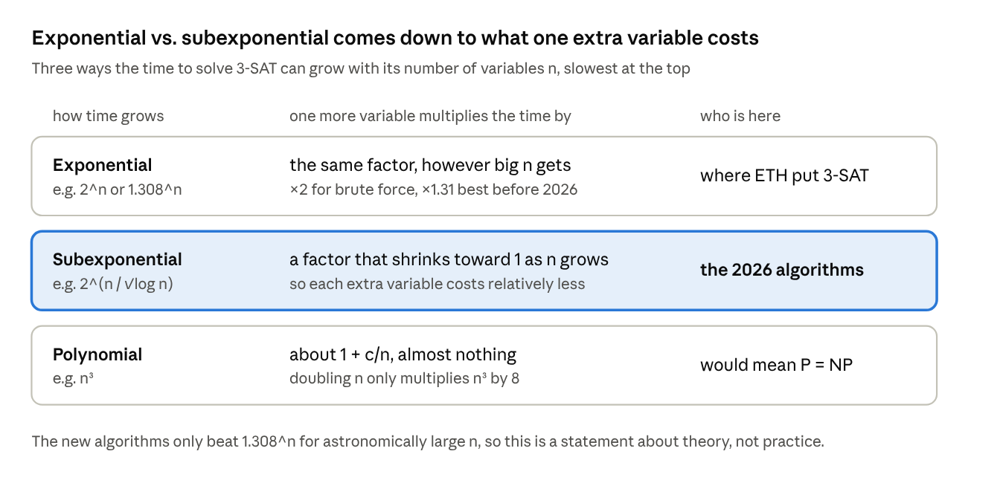
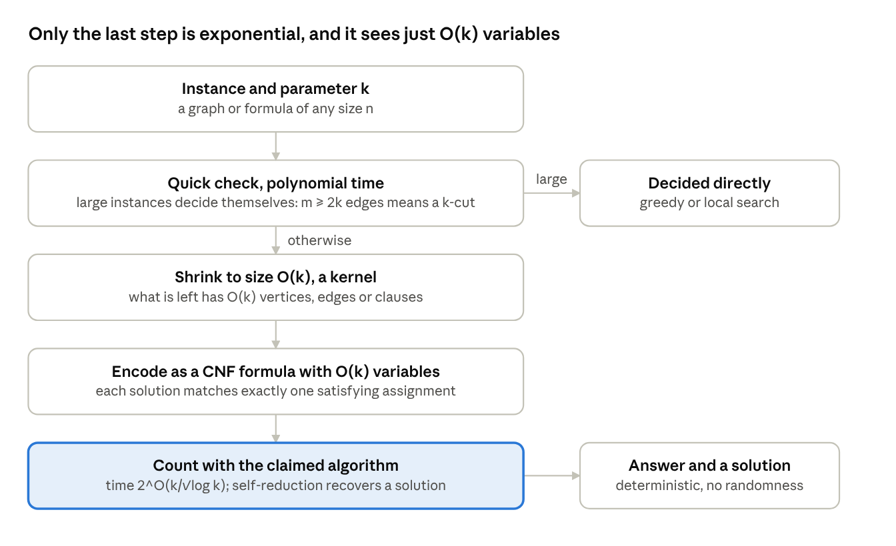
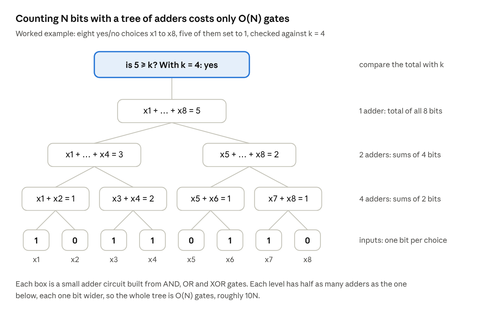
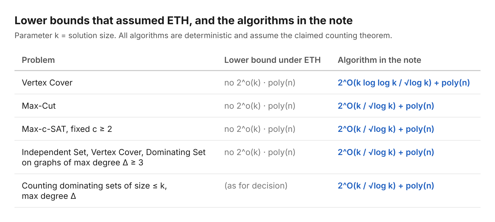

# What happens to parameterized complexity if Exponential Time Hypothesis (ETH) is false?

If the claimed refutation of the Exponential Time Hypothesis (ETH) holds, several famous parameterized problems get algorithms that are subexponential in the solution size k. Among them are Vertex Cover, Max-Cut and Max-c-SAT, whose best-known lower bounds all rested on ETH.

On October 26, 2026, [OpenAI](https://github.com/openai/math/blob/main/preprints/The-Exponential-Time-Hypothesis-is-False-October-25-2026/paper.pdf) and [Anthropic](https://github.com/anthropics/formal-math/tree/main/eth) each released a paper claiming a deterministic algorithm that counts the solutions of a 3-SAT formula in subexponential time. If correct, that refutes ETH, a 1999 conjecture that hundreds of hardness results are built on. Both claims come with Lean proofs and are being reviewed by the group that proposed ETH.

This post walks through [a short note I wrote](../paper.pdf) on one consequence neither paper covers. The note takes the claimed counting algorithm as a black box and turns ETH-based lower bounds in parameterized complexity into explicit algorithms. The results are modest, conditional, and purely theoretical. I'll say exactly what is new and what isn't.

## ETH in one picture

ETH says 3-SAT needs time exponential in its number of variables n. A 3-SAT formula is an AND of clauses, each an OR of up to three variables or their negations. Trying all 2^n assignments always works. Clever algorithms brought that down to about 1.308^n, but the exponent stayed a constant times n.

*What one extra variable costs: exponential, subexponential and polynomial growth.*

The claimed algorithms run in roughly 2^(n/√log n). That is slower than any polynomial, so it says nothing about P versus NP, but faster than 2^(δn) for every fixed δ > 0. That is exactly what ETH ruled out. The algorithms also count solutions instead of just finding one, and that is the property the rest of this post relies on.

## Parameterized complexity, and the lower bounds ETH used to prove

Parameterized complexity measures running time in a second number k, usually the size of the solution, as well as the input size n. A problem is fixed-parameter tractable when it runs in time f(k) times a polynomial in n. The exponential part is confined to k, which is often small.

Vertex Cover is the textbook example. It asks: can you pick at most k vertices so that every edge touches one of them? A simple branching algorithm solves it in about 2^k times poly(n), and decades of work brought the base down to roughly 1.27. Nobody found a 2^o(k) algorithm, and in 2003 [Cai and Juedes](https://doi.org/10.1016/S0022-0000(03)00074-6) explained why. Under ETH there is none. They proved the same 2^o(k) lower bound for:

- Max-Cut: is there a cut with at least k edges?
- Max-c-SAT: can at least k clauses be satisfied at once?
- Independent Set and Dominating Set on graphs of bounded degree

They also proved an equivalence. Every Max-SNP-complete problem has a 2^o(k) poly(n) algorithm if and only if 3-SAT has a 2^o(n) one. So if ETH falls, these lower bounds fall with it. What a refutation does not hand you directly is the algorithm itself, with a concrete running time. That is what the note supplies.

## The recipe: shrink, encode, count

Every result in the note follows the same four moves. The counting algorithm is only subexponential in the number of variables, so the job is to hand it a formula whose variable count is O(k), not O(n).

*The recipe behind every result: shrink, encode, count.*

The expensive step only ever sees O(k) variables, so the total time is 2^o(k) for that step plus a polynomial in n for everything before it. Counting is what makes the encoding easy to trust. If every solution matches exactly one satisfying assignment, the count is the answer, and fixing variables one at a time recovers a solution.

## Three worked examples

**Vertex Cover.** Solve the linear-programming relaxation, where each vertex gets a weight between 0 and 1 and every edge's two weights must add up to at least 1. A classic theorem of [Nemhauser and Trotter](https://doi.org/10.1007/BF01580444) says an optimal solution uses only the values 0, ½ and 1, and that some minimum vertex cover takes every vertex of value 1 and none of value 0.

*The Nemhauser–Trotter kernel splits the vertices into three groups.*

If the LP total exceeds k, the answer is no. Otherwise the vertices of value ½ number at most 2k, and they are the whole problem. Each one gets a variable, each edge becomes a clause "x_u or x_v", and a counting circuit enforces "at most k′ chosen". That is O(k) variables. The kernel can still have about k² edges, which is why Vertex Cover gets the slightly slower rate k log log k/√log k.

**Max-Cut.** Every graph has a cut containing at least half its edges, and local search finds one in polynomial time. So if the graph has at least 2k edges, the answer is yes immediately. Otherwise fewer than 2k edges remain, touching fewer than 4k vertices. Each vertex gets a side variable, each edge gets a "this edge is cut" variable defined by an XOR, and a counting circuit requires at least k cut edges. Everything is O(k) and sparse, which gives the faster rate k/√log k.

**Bounded-degree graphs.** When every vertex has at most Δ neighbours, size alone decides large instances. A greedy pass finds an independent set of size n/(Δ+1), so a graph with at least (Δ+1)k vertices always has one of size k. A dominating set needs at least n/(Δ+1) vertices, so a graph with more than (Δ+1)k vertices never has one of size k. Either way, any instance that survives has O(k) vertices. For dominating sets the encoding is exact, so the note can count them, not just find one.

## The one fiddly part: "at most k" with only O(k) extra variables

Almost every encoding needs a constraint like "at most k of these N variables are true." A careless encoding adds about N log N helper variables. That sounds harmless, but the counting algorithm's running time depends on the total number of variables, and an extra log factor would cancel the whole saving.

The fix is a balanced tree of adders. Pair up the input bits and add each pair, then add those results in pairs, and so on, then compare the final sum with k.

*A tree of adders counts N bits with only O(N) gates.*

Each gate becomes one new variable plus a few three-literal clauses that force it to equal its gate's output (the [Tseitin encoding](https://en.wikipedia.org/wiki/Tseytin_transformation)). For every choice of the inputs, the gate variables have exactly one consistent setting, so the number of solutions is preserved exactly. This device isn't new. Impagliazzo, Paturi and Zane used it in 2001, and Anthropic's paper uses it too. The note just makes the bookkeeping explicit.

## The results, and what is actually new

Assuming the claimed counting theorem, every algorithm below is deterministic and returns a solution when one exists.

*The results, assuming the claimed counting theorem.*
